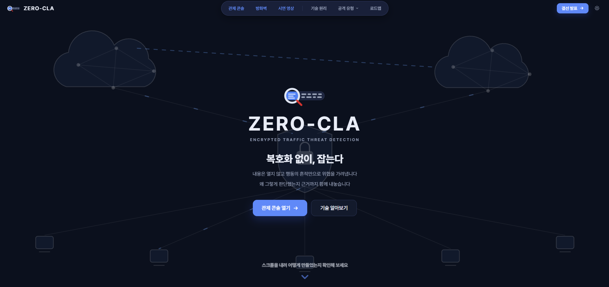
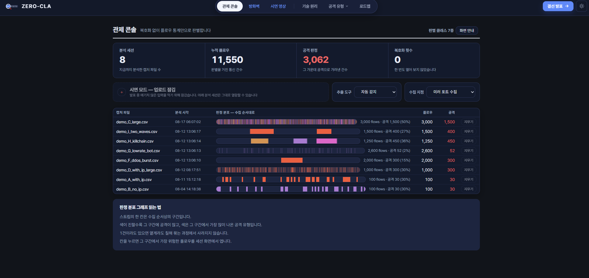
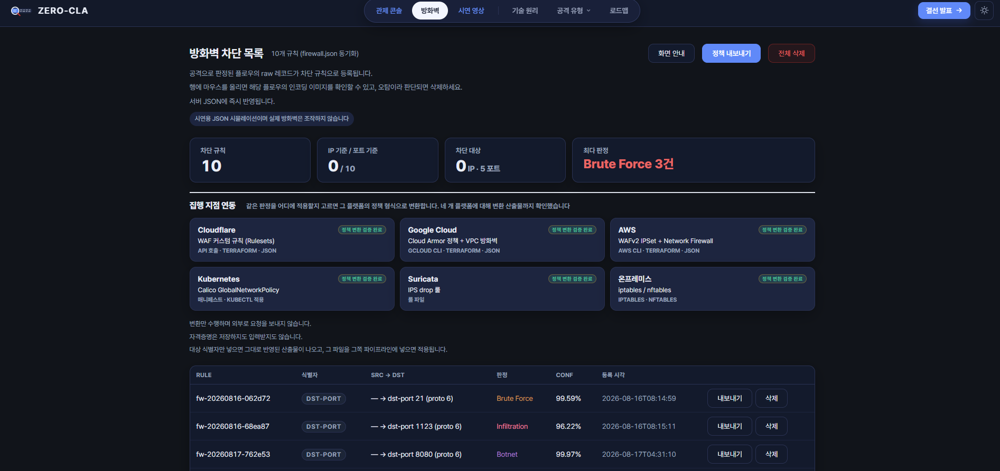
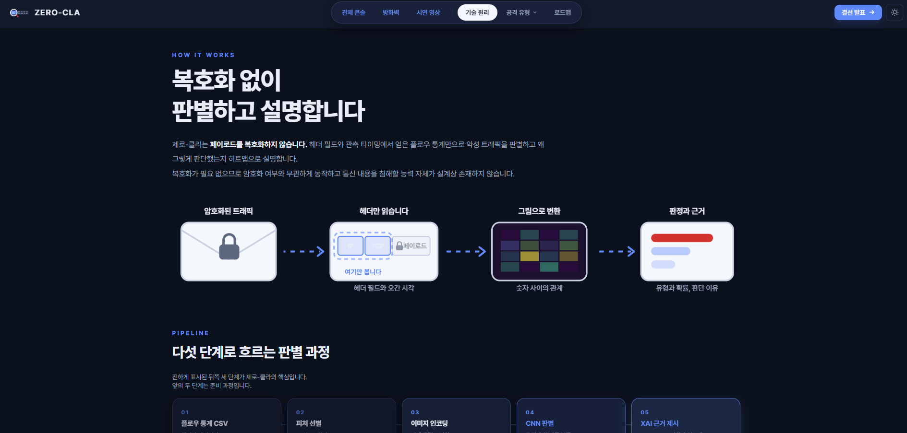

# ZERO-CLA

**ICT 챌린지 2026 · AWS 대표이사상** · Team 제로-클라 · 단국대학교 CSOS Lab

암호화된 트래픽을 복호화하지 않고 플로우 통계만으로 위협을 판별하는 웹 서비스입니다.

---

### 홈

서비스 소개와 각 화면으로 가는 입구입니다.

### 관제 콘솔

캡처 파일(플로우 CSV)을 올리면 플로우마다 공격 여부와 유형을 판정합니다.
판정 분포 막대에서 구간을 누르면 해당 플로우의 Grad-CAM 판단 근거를 볼 수 있습니다.

### 방화벽

공격으로 판정된 플로우를 차단 규칙으로 등록합니다.
같은 규칙을 Cloudflare, Google Cloud, AWS, Kubernetes, Suricata, iptables 정책 형식으로 내보낼 수 있습니다.

### 기술 원리

헤더만 읽고, 숫자 사이의 관계를 이미지로 바꾸고, CNN이 판정한 뒤 근거를 제시하는 흐름을 설명합니다.

### 그 밖의 화면
| 화면 | 내용 |
|---|---|
| 시연 영상 | 관제 콘솔 탐지부터 방화벽 차단까지 시연 |
| 공격 유형 | 판별 가능한 유형과 확장 예정 유형, ATT&CK·CVE 매핑 |
| 로드맵 | ITRC 최우수상, KCC 2026, ICT 챌린지까지의 과정 |
| 결선 발표 | 결선 발표자료 (웹 슬라이드) |

---

모델 학습 코드는 [ITRC2026](https://github.com/dpotlight/ITRC2026) 레포에 있으며 가중치와 데이터셋은 포함하지 않습니다.
